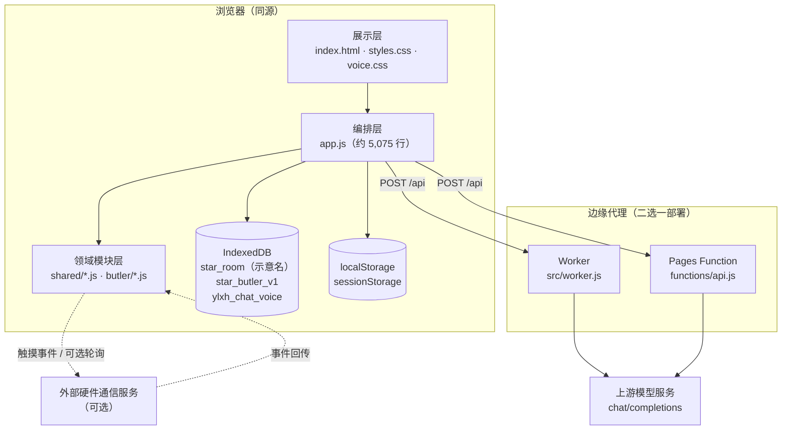

# 01 · 整体架构

> 标记约定见 [索引](README.md)：**✅ 已核实**（附文件路径与行号）、**⚠️ 待核实**。

## 1. 一句话概括

一个**无构建步骤**的纯静态前端，把状态留在浏览器本地；前面挂一层**很薄的代理**，只做两件事——转发模型请求、托管静态文件。前端与代理同源，通过 `/api` 通信。

## 2. 运行形态

| 形态 | 组成 | 说明 |
|---|---|---|
| 前端 | `public/index.html` + `styles.css` + `voice.css` + 30 余个 JS 模块 | 原生 HTML/CSS/JS，无框架、无打包器，浏览器直接执行 |
| 代理 · Worker | `src/worker.js` | 一个 Worker 同时处理 `/api` 与静态资源（`env.ASSETS.fetch`）✅ `src/worker.js:6-44` |
| 代理 · Pages | `functions/api.js` | Cloudflare Pages Function，只处理 `/api`，静态资源由 Pages 托管 ✅ `functions/api.js:14-68` |
| 上游 | OpenAI 兼容 `chat/completions` | 统一走 `https://api.deepseek.com/v1/chat/completions` ✅ `src/worker.js:19`、`functions/api.js:4` |
| 存储 | IndexedDB ×3 + Web Storage | 全部在浏览器侧，代理不读 ✅ `public/app.js:10-38` |
| 可选硬件 | 设备通信地址配置 + 触摸桥 | 前端保留连接入口，✅ 配置存在；⚠️ 完整协议与固件不在本仓库 |

## 3. 分层视图



三个分层的职责边界：

- **展示层**只管 DOM 与样式，不直接发请求。
- **编排层**（`app.js`）是唯一同时接触 UI、存储、模块和网络的代码，负责把一次用户动作串成完整流程。
- **领域模块层**各自只做一件事，通过 `window.*` 全局对象暴露接口，不互相 import（管家子页面除外，见 §6）。

## 4. 前端装配方式

`public/index.html:427-464` 用 38 个 `<script>` 标签按固定顺序加载模块，最后加载 `app.js`，再加载管家抽屉：

```text
life-clock → life-presence → life-topics → life-events → life-state
→ life-context → life-facts → life-scheduler → life-feed
→ transition → butler-intent
→ ai-usage-config → ai-usage → ai-client
→ voice-config → voice-store → voice-service → voice-bubble → voice-recorder
→ touch-bridge
→ persona → persona-memory → long-term-memory-v2 → memory-generator → memory-manager
→ chat-export → room-chat-reader → history-retriever
→ history-window → prompt-layout → request-composer
→ self-narrative → self-narrative-review → self-narrative-dryrun
→ self-narrative-auto → self-narrative-view
→ app.js → butler/drawer.js
```

这个顺序不是装饰：`app.js` 在**模块顶层之外**就开始引用 `window.PromptLayout`、`window.RequestComposer` 等对象（例如 `public/app.js:287`、`public/app.js:308`），所以被依赖者必须先执行。

**代价**：加载顺序即隐式依赖，任何模块改名或拆分都要同步改 HTML，且没有静态检查兜底。这是本项目最明显的结构性负债之一，见 §7。

## 5. 请求路径的唯一出口

前端所有模型调用都收敛到一个函数：

```js
// public/app.js:972-984
async function callAI(messages, options = {}) {
  const client = window.AIClient;
  return client.chat({
    url: API_BASE,        // '/api'（file:// 时为本地代理）
    apiKey: apiKey,       // 用户自填，存在 IndexedDB
    messages,
    timeoutMs: options.timeoutMs,
    signal: options.signal,
    allowEmpty: options.allowEmpty,
    requestType: options.requestType || 'other'
  });
}
```

`API_BASE` 的取值 ✅ `public/app.js:6-8`：

| 场景 | 值 |
|---|---|
| 正常部署（http/https） | `/api` |
| `file://` 直接打开 | `http://127.0.0.1:23210/https://api.deepseek.com/chat/completions`（本地调试用的转发端口，公开仓库不含该转发脚本） |

选 `file://` 分支的原因很实际：本地双击打开 HTML 时没有同源代理可用，只能借一个本机端口转发。这属于开发期便利设施，不是架构的一部分。

## 6. 模块制度的混合

项目里同时存在两种模块形态：

| 形态 | 范围 | 依据 |
|---|---|---|
| 经典脚本 + `window.*` | `public/app.js`、`public/shared/*`、`public/butler/butler-intent.js`、`public/butler/drawer.js` | `public/shared/ai-client.js:5,272`（IIFE 挂载） |
| ES Module | `public/butler/` 子应用（core / db / repository / app） | `public/butler/butler-db.js:9`（`import { SCHEMA_VERSION }`） |

管家子页面是一个独立的 ESM 应用（`public/butler/index.html`），被主页面用 iframe 常驻加载（`public/butler/drawer.js:1-8`）。它通过 `butler-intent.js` 这个经典脚本桥接回主聊天，形成「ESM 子系统 + 全局桥」的混合结构。

**为什么没统一**：管家是后加的功能，ESM 便于测试（`tests/butler/*.test.mjs` 直接 import `butler-core.js`）；而主页面从未构建化，改成 ESM 会波及全部加载顺序。这是一个**刻意保留的过渡状态**，不是遗漏。

## 7. 已知结构性约束

这些不是 bug，但会直接影响后续维护，读代码前先知道能省不少时间。

1. **编排层过重**。`public/app.js` 单文件承担存储访问、请求组装、上下文注入、语音、触摸、调度、UI 渲染。任何改动都可能牵动主聊天，且没有单元测试覆盖。
2. **加载顺序即依赖**。见 §4，无静态检查。
3. **两套代理并存**。`src/worker.js` 与 `functions/api.js` 行为对齐但不等价（超时、方法校验、错误码），✅ 对比如下：

   | 维度 | Worker | Pages Function |
   |---|---|---|
   | 非 `/api` 请求 | 交给 `env.ASSETS` ✅ `src/worker.js:43` | 由 Pages 处理，函数不参与 |
   | 非 POST 的 `/api` | 直接 `request.json()`，失败落到 500 ✅ `src/worker.js:18,37-39` | 显式返回 405 ✅ `functions/api.js:21-26` |
   | 上游超时 | 无显式超时 ✅ `src/worker.js:19-26` | 40 秒 `AbortSignal.timeout` ✅ `functions/api.js:6,46` |
   | 缺 Key 时 | 仍发请求，由上游返回 401 ✅ `src/worker.js:23` | 本地直接 500 `DEEPSEEK_API_KEY 未配置` ✅ `functions/api.js:28-35` |
   | 错误码 | 仅 `{error}` ✅ `src/worker.js:38` | `{error, code}`，区分 `UPSTREAM_TIMEOUT` / `UPSTREAM_ERROR` ✅ `functions/api.js:59-66` |

4. **两条 API Key 路径同时存在**：服务端环境变量与用户自填。当前实现中代理会用环境变量**覆盖**客户端传来的 `Authorization`，因此自填 Key 实际未参与上游鉴权。详见 [06 · API](06-api.md) 第 5 节。
5. **两套数据层**：房间用 `star_room`（示意库名，原始库名含个人昵称，公开文档统一替换），管家用 `star_butler_v1`，另有语音库 `ylxh_chat_voice`。三者互不引用，管家页面也不读聊天库。这是有意的隔离（见 [05 · 存储](05-data-storage.md)）。

## 8. 一次对话经过的层

把上面的结构串起来，一条普通文字消息的路径是：

```text
输入框 → sendUserTurn（落库 + 本地意图短路）
      → requestStarReply（打字看门狗）
      → doRequestStarReply（拉上下文、裁历史、组装 messages）
      → callAI → AIClient.chat → POST /api
      → 代理 → 上游模型
      → 解析正文 → 落库 → 渲染 → 可选语音/翻译
```

逐段细节、每一步的行号与失败分支，见 [03 · 消息与 AI 请求流程](03-request-flow.md)。
