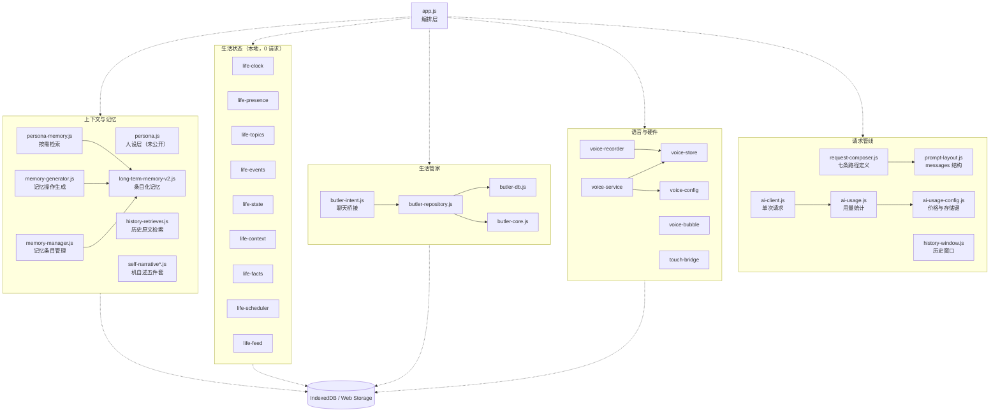

# 02 · 核心模块与依赖关系

> 标记约定见 [索引](README.md)。本页只讲模块职责与调用方向，具体算法见 [03](03-request-flow.md)、[04](04-memory-and-history.md)。

## 1. 依赖总图

箭头方向 = 调用/读取方向。虚线 = 通过 `window.*` 全局对象隐式引用（无 import 语句，靠 `index.html` 加载顺序保证）。



## 2. 模块清单

「公开状态」一列对应本仓库当前实际内容；标注「已公开」的文件都在 `public/`、`src/`、`functions/`、`tests/` 下。

### 2.1 编排与展示

| 文件 | 职责 | 主要依赖 | 规模 | 公开状态 |
|---|---|---|---|---|
| `public/app.js` | 唯一编排层：存储读写、请求组装、上下文注入、渲染、语音、触摸、调度 | 几乎全部 `window.*` 模块、3 个 IndexedDB | 5,075 行 | **已公开** |
| `public/index.html` | 页面骨架 + 38 个脚本装配 + 内联样式 | — | — | **已公开** |
| `public/styles.css` | 主样式 | `shared/tokens.css` 变量 | 351 行 | **已公开** |
| `public/voice.css` | 语音气泡与录音控件样式 | tokens | 290 行 | **已公开** |
| `public/shared/tokens.css` | 设计变量（颜色/圆角/阴影/动效时长） | 无 | 15 行 | **已公开** |

### 2.2 请求管线（本项目最值得读的部分）

| 文件 | 职责 | 依赖 | 公开状态 |
|---|---|---|---|
| `public/shared/ai-client.js` | 单次聊天请求：45s 超时、AbortController 合成、错误分类（`TIMEOUT`/`NETWORK`/`HTTP`/`BAD_RESPONSE`/`ABORTED`/`NO_KEY`/`EMPTY`）、usage 解析、「输入中」看门狗 | `fetch`、`AbortController`，可选 `AIUsage` | **已公开** |
| `public/shared/prompt-layout.js` | 把 `stableSystem / history / dynamicContext / currentTurn` 拼成 messages；含当前消息重复守卫 | 无（纯函数） | **已公开** |
| `public/shared/history-window.js` | 请求层历史窗口：同 role 合并、24000/20000 滞回裁剪、剥离当前消息 | 无（纯函数） | **已公开** |
| `public/shared/request-composer.js` | 七条请求路径的规格表与统一组装入口 | `PromptLayout`（可注入） | **已公开** |
| `public/shared/ai-usage.js` | 用量统计：环形缓冲 2000 条，只存时间/模型/类型/token/费用 | `AIUsageConfig`、`localStorage` | **已公开** |
| `public/shared/ai-usage-config.js` | 价格表、存储键、请求类型名称的唯一配置点 | 无 | **已公开** |

**为什么这三个纯函数先公开**：它们不读库、不发请求、不碰 DOM，行为完全由入参决定，且有直接单元测试（见 §4）。即使你不关心这个项目，`history-window` 的滞回裁剪与 `prompt-layout` 的重复守卫也可以直接搬到别处用。

### 2.3 上下文与记忆

| 文件 | 职责 | 公开状态 |
|---|---|---|
| `public/shared/persona.js` | 角色人设分层注入（背景/关系/特殊/功能提示词） | **已公开**（内嵌的真人设已替换为占位示例） |
| `public/shared/persona-memory.js` | 三类动态资料按需检索：长期记忆 / 日记 / 珍藏；会话级去重 | **已公开** |
| `public/shared/long-term-memory-v2.js` | 长期记忆条目化：v1 字符串 → v2 条目，baseline 镜像回退 | **已公开** |
| `public/shared/memory-generator.js` | AI 只提议 `add/revise/retract`，程序验证并落库 | **已公开** |
| `public/shared/memory-manager.js` | 设置页的条目管理接口（增删改撤回归档，均写 history） | **已公开** |
| `public/shared/history-retriever.js` | 更早聊天原文的按需检索（L1/L2/L3 三档） | **已公开** |
| `public/shared/self-narrative*.js`（5 个） | 机自述数据层 / 审核 / 试跑 / 自动规则 / 视图 | **已公开**（5 个文件均在仓库；默认文案为示例，不含私人关系数据） |

### 2.4 生活状态（本地规则，零网络）

这组模块的设计目标很明确：**在不让模型参与的前提下，让「现在几点、在不在、今天发生过什么」变成可注入的短上下文**。

| 文件 | 职责 | 存储 | 公开状态 |
|---|---|---|---|
| `life-clock.js` | 本地时区日期/时间纯函数（`YYYY-MM-DD`） | 无 | **已公开** |
| `life-presence.js` | 记录在线/交互时间，不做行为判断 | `localStorage['ylxh.life.v1']` + `sessionStorage['ylxh.life.sid']` | **已公开** |
| `life-topics.js` | 话题回避规则（上限 8 条），区分「永久回避」与「本次不想聊」 | `localStorage['ylxh.topic.avoid.v1']` | **已公开** |
| `life-events.js` | 只记录「已发生/已确认」的事件 | `localStorage['ylxh.life.log.v1']` | **已公开** |
| `life-state.js` | 聚合「正在发生/计划/已结束」，只读 | 读他人存档 | **已公开** |
| `life-context.js` | 由 `LifeClock + LifePresence + LifeEvents` 生成快照与提示词段落，只输出计数与类别 | 无 | **已公开** |
| `life-facts.js` | 仅在问题指向某类事实时读一次（背词/电台/读书/待办/聊天时间） | 只读 | **已公开** |
| `life-scheduler.js` | 单 tick（可见时 60s）、单锁（多标签互斥）、单预算 | `localStorage['ylxh.sched.*']` | **已公开** |
| `life-feed.js` | 「小屋的动静」展示层，读 keeps/starDiaries | 只读 | **已公开** |

**隐私设计值得单独注意**：`life-context.js` 只输出「计数与类别概括」，明确不输出待办标题、金额、睡眠、生理期、日记/信件正文（模块头注释即为约束）。这是「本地数据也能安全进提示词」的关键取舍。

### 2.5 生活管家（ESM 子系统）

| 文件 | 职责 | 模块形态 | 公开状态 |
|---|---|---|---|
| `butler-core.js` | 纯逻辑：日期、uid、睡眠、周期预测、任务状态机 | ESM | **已公开** |
| `butler-db.js` | IndexedDB `star_butler_v1` 数据层，升级只增不删 | ESM | **已公开** |
| `butler-repository.js` | 领域仓储，封装 CRUD | ESM | **已公开** |
| `butler-intent.js` | 聊天意图桥接：AI 只输出 `<bl>{...}</bl>`，本地执行增删改查 | 经典脚本 | **已公开** |
| `butler-app.js` | 管家独立页面交互 | ESM | **已公开** |
| `drawer.js` / `drawer.css` | iframe 常驻抽屉控制器 | 经典脚本 | **已公开** |

管家的核心设计是**「AI 只识别意图，不碰数据」**：模型输出一个标记块，字段解析、校验、写入全部由本地代码完成（`butler-intent.js:1-7`）。这样账单与待办的历史数据不需要发给模型，也避免了模型编造金额。

### 2.6 语音、硬件与工具

| 文件 | 职责 | 公开状态 |
|---|---|---|
| `voice-service.js` | TTS/ASR 适配层，页面只认识 `synthesize()` / `create()` | **已公开** |
| `voice-store.js` | 音频片段存储（IndexedDB `ylxh_chat_voice` / `clips`） | **已公开** |
| `voice-recorder.js` / `voice-bubble.js` / `voice-config.js` | 录制、气泡渲染、配置 | **已公开** |
| `touch-bridge.js` | 硬件触摸事件前端接收层：跨标签去重、提示条、可选轮询 | **已公开** |
| `transition.js` | 页面转场动画 | **已公开** |
| `chat-export.js` / `room-chat-reader.js` / `room-keeps.js` | 聊天导出 / 只读读取器 / 珍藏读取 | **已公开** |
| `note-card.js` | 今日便签（任务由 Agent 发起、用户执行） | **已公开** |
| `backup-format.js` / `backup-io.js` | 备份格式（纯函数）/ 落盘 | **已公开** |
| `cleanup.js` / `migrate.js` / `purge-today-ui.html` | 一次性数据整理工具 | **已公开** |
| `generate-stickers.cjs` | 素材目录 → `manifest.json` 构建脚本 | **已公开** |

### 2.7 服务端

| 文件 | 职责 | 公开状态 |
|---|---|---|
| `src/worker.js` | `/api` 代理 + 静态资源 | **已公开** |
| `functions/api.js` | Pages Function 版 `/api` 代理，含 40s 上游超时与错误码 | **已公开** |
| `wrangler.toml` | Worker 入口与 assets 绑定 | **已公开** |

## 3. 依赖规则

项目没有强制的分层校验，但代码基本遵守三条约定：

1. **单向**：展示层 → 编排层 → 领域模块 → 存储。领域模块不反向调用 `app.js`，需要外部能力时通过参数注入（例如 `persona-memory.js` 由 `app.js` 传入 `longTermMemoryV2` 与 `v2State`）。
2. **存储能力注入**：需要读写的模块接受 `store: { get, set }`（如 `memory-manager.js:1-10`），因此在 Node 测试里可以换成内存实现，不碰浏览器 API。
3. **失败静默降级**：上下文类模块的异常在 `app.js` 内被 `try/catch` 吞掉（如 `public/app.js:1282,1295,1306,1317`），保证「记忆读失败」不会变成「消息发不出去」。

**违反约定的地方**（可在重构时优先处理）：

- `history-retriever.js:1` 注释仍写「未接入主聊天」，但实际已在 `public/app.js:1714` 通过 `collectChatHistoryEvidence` 调用。属于文档漂移。
- `request-composer.js` 既定义路径，又内嵌任务文本与角色口吻，导致「通用组装」与「私有提示词」耦合。
- 日期处理至少四份实现：`life-clock.js`、`butler-core.js`、`butler-intent.js:13-16`、`note-card.js`。

## 4. 测试覆盖

| 模块 | 测试 | 覆盖内容 |
|---|---|---|
| `life-clock.js` | `tests/shared/life-clock.test.mjs`（C01–C14） | **已公开** |
| `history-window.js` | `tests/shared/history-window.test.mjs`（H1–H17） | **已公开** |
| `prompt-layout.js` | `tests/shared/prompt-layout.test.mjs`（P1–P8） | **已公开** |
| `butler-core.js` | `tests/butler/{cycles,sleep,cycles-open,tasks}.test.mjs` | **已公开** |

前三个测试本轮已随源码一起纳入公开仓库（`prompt-layout` 的测试因夹具含专属文本，暂未纳入）。运行方式：

```bash
node --test "tests/shared/*.test.mjs"
```

无第三方依赖，Node 18+ 自带 `node:test` 即可（实测 Node 22.22.2，31/31 通过）。

> 注意：部分 Node/Windows 组合下 `node --test tests/shared/`（传目录）会被当成模块路径而报 `MODULE_NOT_FOUND`，用上面的通配符形式更稳。
