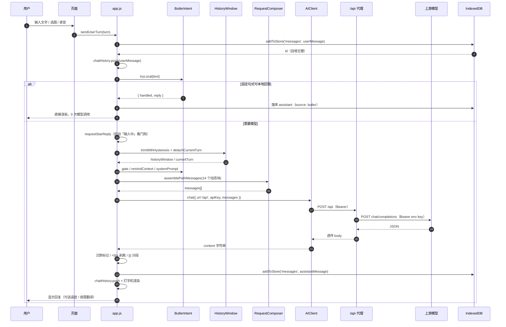
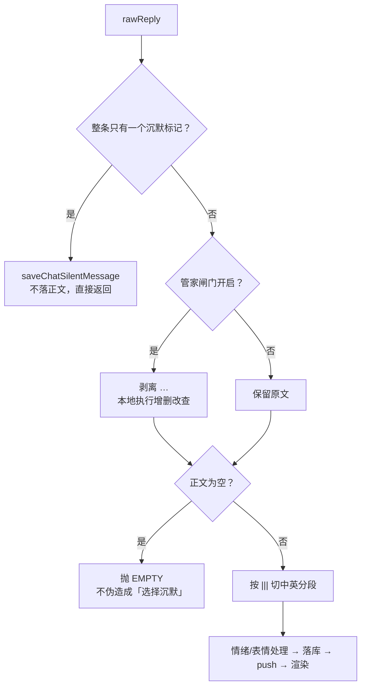

# 03 · 消息与 AI 请求流程

> 本页是主链路（普通文字聊天）的逐段说明。行号基于 `public/app.js` 5,075 行版本。

## 1. 全链路时序



## 2. 第一阶段：写入用户消息

入口是 `sendUserTurn`（`public/app.js:1835-1944`），文字、图文、语音都走这里，没有旁路。

### 2.1 前置守卫

| 顺序 | 条件 | 行为 | 依据 |
|---|---|---|---|
| 1 | `isSending` 为真 | 直接返回 `false`，防并发 | `1836` |
| 2 | 文本、图片、语音全为空 | 返回 `false` | `1843` |
| 3 | 没有 API Key | toast 提示后返回 `false` | `1844` |
| 4 | 历史尚未加载完成 | 先 `await ensureMessagesLoaded()`，期间锁按钮但不清输入框 | `1848-1858` |

第 4 条是有意设计：如果历史还在读，此时把「空内存」当空历史发出去，模型会以为什么都没发生过。等待失败也会解锁，用户输入不会丢。

### 2.2 落库顺序

```text
addToStore('messages', userMessage)   // 先落库，拿到自增 id
  → chatHistory.push(userMessage)     // 再进内存
  → LifePresence.interaction()        // 有效互动计数
  → 清输入框 / 清搜索框 / renderMessages()
```

顺序不能反：先落库才有 `id`，后续的历史窗口、去重守卫、重试入口都依赖这个 `id`。落库失败时 `saved` 保持 `false`，语音消息的调用方据此保留录音（`public/app.js:1833` 注释）。

用户消息对象形状（`1869-1876`）：

```js
{ role: 'user', content, image, time, id }
// 语音消息额外带：
{ type: 'voice', audioClipId, audioMime, durationMs, asrStatus }
```

### 2.3 本地短路（0 次模型调用）

落库后先给生活管家两次机会：

| 分支 | 触发 | 结果 | 依据 |
|---|---|---|---|
| 高置信本地查询 | 固定句式完全匹配（如「这个月花了多少」） | 本地算完直接回，`source:'butler'` | `1900-1910` |
| 待处理上下文补全 | 上一轮在等「几点」「多少元」 | 本地补完并保存 | `1912-1922` |

短路命中时**不进入** `requestStarReply`，因此不占用量、不触发打字气泡、不受沉默规则影响。这是「能本地算的绝不问模型」这一原则最直接的体现。

## 3. 第二阶段：请求上游

### 3.1 打字状态看门狗

`requestStarReply`（`1248-1260`）只做一件事：启动 60 秒看门狗，`finally` 里必定关闭。

```js
const guard = client.createTypingGuard({ watchdogMs: 60000, onChange: setTyping });
guard.start();
try { return await doRequestStarReply(userMessage); }
finally { guard.stop(); }   // 成功 / 失败 / 超时 / 异常都会走到
```

看门狗比请求超时（45s）更晚，保证「请求层出意外」时气泡也不会一直转（`ai-client.js:238-241` 注释）。

### 3.2 上下文收集

`doRequestStarReply`（`1602-1818`）是本项目最长的一个函数（约 216 行），按顺序做 8 件事：

| # | 步骤 | 产出 | 依据 |
|---|---|---|---|
| 1 | 生活管家闸门 | `blGate` 决定是否追加管家系统提示 | `1609` |
| 2 | 亲近/情绪轮次判定 | `closeTalk` 关掉「可以不说话」 | `1611` |
| 3 | 提醒上下文 | `blRemind`，90 秒节流扫描 | `1614-1620` |
| 4 | 历史窗口 | `trimWithHysteresis` → `detachCurrentTurn` | `1623-1631` |
| 5 | 一次性上下文 | 游戏结果、近 24h 活动（最多 3 条） | `1635-1659` |
| 6 | 话题回避 + 生活快照 + 便签 + 事实 | 4 段短文本 | `1660-1701` |
| 7 | 人设按需 + 三类资料按需 + 历史原文检索 | `personaPart` / `dynamic` / `historyBlock` | `1704-1714` |
| 8 | 当前消息转换 | `messageToAI(currentSource)` | `1718-1719` |

第 6、7 步全部是**条件注入**：普通闲聊不读库、不扫内存、不多发请求。这是控制 token 成本的主要手段，详见 [04](04-memory-and-history.md)。

### 3.3 组装 messages

主聊天也走统一的路径适配器（`1721-1743`）：

```js
const messages = assemblePathMessages({
  taskInstruction: rcTask('chat', getActionDensityPrompt() + '\n请结合上下文自然回应。'),
  blocks: [ schedule, closeTalk, game, activity, lifeContext,
            lifeFacts, topics, note, persona, dynamicMemory,
            silence, remind, butler, history ],   // 14 个块
  history: historyWindow,
  currentTurn,
  currentMessageId: userMessage.id
});
```

最终结构（`prompt-layout.js:46-76`）：

```text
[0] { role:'system',  content: 稳定层（核心人设 + 机制 + 路径任务） }
[1..n] 历史消息（同 role 已合并）
[n+1] { role:'system',  content: 动态上下文（14 块拼接，带统一表头） }   // 可选
[last] { role:'user',   content: 当前消息 }                            // 原样挂载
```

三个约束值得注意：

- **动态上下文用真实 `system` role**，不靠文本标签伪装（`prompt-layout.js:9-11` 注释）。作者明确记录了「后置 system 的优先级未被上游文档保证」这一风险，属于已知取舍。
- **当前消息从历史窗口剥离后重新挂载**，并用 `currentMessageId` 做守卫：如果历史里仍残留同一条，直接抛 `CURRENT_MESSAGE_DUPLICATE`（`prompt-layout.js:58-64`）。这解决的是「用户消息刚落库就进内存，历史窗口又包含它」导致的重复发送。
- **多模态只转换当前消息**。`messageToAI`（`837`）在检测到图片时调用 `buildVisionContent`（`822`）把 `content` 变成 `[{type:'text'}, {type:'image_url'}]` 数组；历史消息保持字符串，避免每轮重传图片。

### 3.4 发请求

```text
callAI (972-984)
  → AIClient.chat (ai-client.js:159-208)
      → postJSON：合成外部 signal 与 45s 超时 (ai-client.js:52-95)
      → POST /api，headers: { Content-Type, Authorization: Bearer <用户自填 Key> }
      → body: { model: 'deepseek-flash', messages, stream: false }
      → 解析 choices[0].message.content
      → recordUsage（成功/失败各记一条，不存正文）
```

一次 `chat()` = 一次真实请求。项目内没有自动重试；调用方手动重试会产生新请求，用量也另行记账（`ai-client.js:190` 注释）。

## 4. 第三阶段：处理回复

按顺序四道关卡，顺序不能调换：



| 关卡 | 规则 | 依据 |
|---|---|---|
| 沉默 | 只认「整条回复只有一个完整标记」；有正文或 JSON 坏掉都不算沉默 | `1754-1763` |
| 管家 | `<bl>` 标记剥离后交给本地执行；管家轮次不允许被沉默吞掉 | `1765-1769` |
| 空正文 | 标记不完整且无正文 → `EMPTY` 错误，不伪造沉默 | `1771-1773` |
| 中英分段 | `|||` 前为中文、后为英文（可选） | `1775-1781` |

落库之后才做三件「副作用」：标记动态资料已发送（`1811-1813`）、投递提醒（`1797-1799`）、触发珍藏检测（`1807`）。顺序原则是**先确保回复真的存下来，再认为它发生过**。

## 5. 七条请求路径

`request-composer.js:10-57` 定义了全部路径。除了主聊天，其余路径都是一次性任务，不参与历史窗口：

| 路径 | 用途 | requestType | 动态块 | 特殊选项 |
|---|---|---|---|---|
| `star` | 主动关心 / 特殊互动 | `star` | schedule | — |
| `chat` | 主聊天 | `chat` | 14 块全量 | — |
| `todayLetter` | 回应今日来信 | `letter` | 无 | — |
| `futureLetter` | 回应未来信 | `letter` | 无 | — |
| `diary` | 写一篇日记 | `diary` | 无 | — |
| `keep` | 提出珍藏建议 | `keep` | 无 | 要求输出单行标记 |
| `touch` | 硬件触摸互动 | `touch` | schedule / 触摸函数 / 触摸事实 | `allowEmpty: true` |

`touch` 是唯一允许空回复的路径：硬件触发时模型可以选择「不回应」，因此 `AIClient` 对 `allowEmpty` 返回空串而不是抛 `EMPTY`（`ai-client.js:202-206`）。

## 6. 失败语义与重试

| 阶段标记 | 何时设置 | 含义 |
|---|---|---|
| `save-user` | 用户消息落库前 | 失败 = 消息没存下来，不提供重试入口 |
| `local` | 落库后、请求前 | 失败 = 本地处理问题 |
| 其他（请求/保存） | 请求发出后 | 失败 = 写入 `pendingReplyRetry`，界面出现重试入口 |

错误文案由 `chatErrorMessage` 按 `stage` 拼接，底层错误码来自 `AIClient.friendly`（`ai-client.js:211-236`）。关键区分：**「你的消息已保存，可以重试」只在用户消息确实落库后才会出现**，避免用户以为消息丢了。

## 7. 已知偏差与待核实项

| 项 | 现象 | 判断 |
|---|---|---|
| 响应 Content-Type | 客户端发 `stream:false` 并按 JSON 解析；代理却返回 `Content-Type: text/event-stream` | ✅ 代码事实；功能不受影响（body 仍是 JSON），但头信息误导，⚠️ 是否有意保留待确认 |
| CORS 允许头 | `Access-Control-Allow-Headers` 只有 `Content-Type`，不含 `Authorization` | ✅ 代码事实；同源 `/api` 不触发预检所以正常，跨域部署会失败 |
| 上游超时 | Worker 版无显式超时，Pages 版 40s | ✅ 代码事实；Worker 依赖客户端 45s 断开 |
| 重试 | 无自动重试，无退避 | ✅ 代码事实；由用户手动触发 |
| 并发 | 只靠 `isSending` 布尔锁，刷新页面即丢失 | ✅ 代码事实；多标签同时发送未做互斥 |
