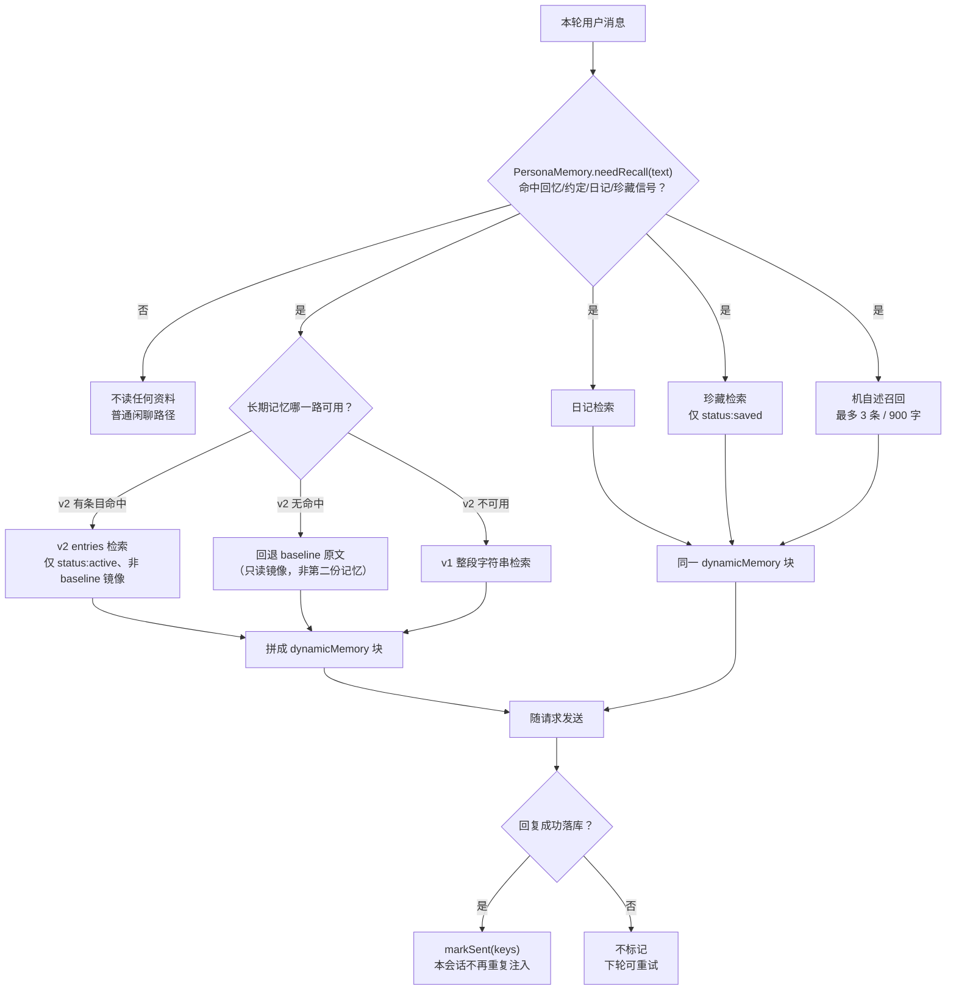

# 04 · 历史记录与记忆机制

> 这个项目里「记忆」不是一个东西，而是四套机制叠在一起。混着讲最容易糊涂，所以先给一张分工表。

## 1. 四套机制的分工

| 层 | 模块 | 时间尺度 | 存哪里 | 何时进提示词 |
|---|---|---|---|---|
| A. 请求层历史窗口 | `history-window.js` | 最近几十轮 | 不落库，内存副本 | 每轮必进（按字数裁剪） |
| B. 按需历史检索 | `history-retriever.js` | 更早的原文 | 读已加载内存，必要时读 IndexedDB | 命中「回忆/之前/记得」等信号才进 |
| C. 长期记忆 | `long-term-memory-v2.js` + `persona-memory.js` + `memory-generator.js` | 跨月、稳定事实 | KV `longTermMemory`（v1）/ `longTermMemory.v2`（v2） | 按需，且会话去重 |
| D. 机自述 | `self-narrative*.js` | 主观认知，允许不确定 | KV（独立键） | 按需，最多 3 条 / 900 字 |

外加两类「原件」，它们不是记忆，但会被 C 层引用：

- **日记** `diaries`（含 `type:'note-day'` 的今日便签，共用一张表）
- **共同珍藏** `keeps`（只有 `status:'saved'` 才算已确认）



## 2. A 层：请求层历史窗口

`history-window.js` 解决三个很具体的问题，每个都对应一个曾经踩过的坑。

### 2.1 同 role 合并，但不能丢消息

连续两条 `user` 消息（例如用户连发两句）在某些上游实现里会被拒或语义错乱，所以要合并。但简单合并会丢掉逐条身份，导致「删除某一条」或「当前消息去重」失效。

做法：合并组带上 `sourceIds` / `originalIds` / `parts`，`parts` 保留每一条的原文、图片引用与原始对象（`history-window.js:67-81`）。

```
合并组 {
  role, content(拼接), parts: [{id, originalId, text, image, source}],
  sourceIds[], originalIds[], tempId, id(仅单条时保留)
}
```

### 2.2 24000 / 20000 滞回裁剪

朴素的「超过阈值就截断」会导致每轮都在边界附近抖动：加一句裁一句，system 前缀反复变化，缓存命中率归零。

因此用滞回（`history-window.js:18-19`）：

| 参数 | 值 | 作用 |
|---|---|---|
| `HARD_LIMIT` | 24,000 字符 | 超过才触发裁剪 |
| `SOFT_LIMIT` | 20,000 字符 | 一次裁到这里，留出 4,000 字余量 |
| `state.leftKey` | 左边界消息 key | 钉住左边界，窗口不左移 |

效果：窗口只在「真的超了」时动一次，且一次裁掉足够多，避免连续多轮都改前缀。

### 2.3 剥离当前消息

当前 user 消息刚落库就已 `push` 进内存，如果直接拿内存当历史，它会出现在 messages 中间，再在末尾挂一次 → 重复发送。

`detachCurrentTurn`（`history-window.js:244-297`）把它从窗口里取出并原样返回，由 `prompt-layout.assembleMessages` 挂到末尾，并用 `currentMessageId` 做守卫。**窗口里若残留同一条，直接抛错而不是静默去重**——宁可失败，也不发一条结构可疑的请求。

### 2.4 ID 策略

只作用于请求层临时副本，不写回数据库：

| 情况 | 处理 |
|---|---|
| 正常 id | 原样使用 |
| 重复 id | `<id>#dup<n>`，`parts[]` 里保留 `originalId` 与 `source` |
| 缺失 id | `hw:idx:<index>` 合成身份 |
| 合并/拆分组 | 用 `hw:group:<index>`，不继承任何单条主键 |

比较统一走 `String(id)`，避免数字/字符串主键混用（`history-window.js:8-13` 注释）。

## 3. B 层：按需历史检索

`history-retriever.js` 负责「翻更早的聊天原文」，只在三类信号下动作：

| 档位 | 触发 | 行为 |
|---|---|---|
| L1 | 明确指代（「上次」「那天」） | 窄范围检索 |
| L2 | 需要跨段回忆 | 扩大范围 |
| L3 | 明确要求翻旧账（「很久以前」「从头」） | 最大范围 |

三条硬规则（模块头注释 `history-retriever.js:1-12`）：

1. **先后顺序只认 `time`**，`id` 只用于去重与引用，绝不参与「谁更早」。
2. **范围不可靠时不猜**：返回 `abstained`，不把不确定范围里的消息包装成证据。
3. **没有「真正扫完」的证据就不能说 `exhausted`**，预算耗尽不算扫完。

失败时宁可回答「没找到」，也不推测——这条在陪伴类应用里比检索率更重要。

**跨轮继承**：`app.js` 里有一个只存在内存的 `recallSession`（`public/app.js:1357` 起），记录上一轮命中的消息 id。下一轮如果判定「还在说同一件事」（`recallShouldCarry`），就直接复用上轮原文；如果原文已被删除，则作废会话，不返回半截结论（`public/app.js:1509-1512` 注释）。

> ⚠️ **文档漂移**：`history-retriever.js:1` 的注释仍写「独立模块，未接入主聊天」，但实际已由 `collectChatHistoryEvidence` 在 `public/app.js:1714` 调用。以代码为准。

## 4. C 层：长期记忆

### 4.1 两代并存

| 代 | 键 | 形态 | 状态 |
|---|---|---|---|
| v1 | `longTermMemory` | 一整段字符串 | **永不删除、永不覆盖**，作为回退 |
| v2 | `longTermMemory.v2` | 条目数组，每条带 `id/text/category/source/createdAt/updatedAt/status` | 当前主路径 |

初始化是幂等的，且并发串行：重复/并发调用不会产生重复条目（`long-term-memory-v2.js:1-20`）。

v1 迁移到 v2 时有一条保守规则：**解析不确定就整段原样保留为一条 `baseline` 镜像条目**，标注 `baselineRole='fallback-only'`、`source.mirrorOfBaseline=true`。baseline 只用于回退与校对，**不参与逐条检索**，避免同一段记忆被当成两份注入。

### 4.2 检索优先级（严格互斥）

`persona-memory.js` 规定三路只能选一路（`persona-memory.js:1-12`）：

```
v2 entries 命中  →  用条目
v2 无命中        →  回退 baseline 原文（按 v1 片段规则）
v2 不可用/异常   →  回退 v1 整段
```

「绝不两路同时注入」是硬约束，防止同一事实以两种措辞重复出现。

### 4.3 写入：AI 提议，程序执行

`memory-generator.js` 的核心设计：

- 模型只输出 `add` / `revise` / `retract` 三种**逐条操作**；
- 来源 id、时间、确认状态、元数据**全部由程序按真实记录补齐**，模型无权编造；
- 每条操作独立执行，单条失败不影响其他；
- 证据不足或存在模糊冲突 → **保留原记忆**；用户明确纠正优先。

触发方式是**手动**：设置页点击整理（`generateMemory`，`public/app.js:4011-4040`），不是后台常驻任务。没有自动整理定时器。

`memory-manager.js` 是同一套条目接口的 UI 侧封装：新增/编辑/撤回/恢复/归档全部走 v2 的保留接口，因此必然写入 `history`，不另造结构（`memory-manager.js:1-12`）。

## 5. D 层：机自述

`self-narrative*.js` 是五个独立模块：

| 文件 | 职责 |
|---|---|
| `self-narrative.js` | 数据层：读写记录、`list()`、`contextPart()` |
| `self-narrative-review.js` | 单批审核 |
| `self-narrative-dryrun.js` | 试跑（不落库） |
| `self-narrative-auto.js` | 自动规则：纠正检测、相关记录筛选 |
| `self-narrative-view.js` | 展示 |

它的定位与长期记忆明确区分（`self-narrative.js:1-12`）：

> 机自述 = Agent 眼中的用户：观察、印象、理解、猜测、好奇，以及还没弄清的问题。
> 不是日记、不是共同珍藏、不是长期记忆、不是隐藏思维链。

因此**允许保留不确定性**，文本里可以写「我还不确定」。召回时只取 `status:'active'` 的记录，`retracted` / `superseded` 不进池；最多 3 条、上限 900 字（`public/app.js:1342-1348`）。

两个细节：

- 召回是**只读**的：`store.set` 直接抛错（`public/app.js:1326-1329`），从代码层面禁止「读的时候顺手写」。
- 用户明确追问（「你记得我什么」）时忽略会话去重，允许再次注入；纠正语境（「你记错了」）时临时抑制相关旧认识，但不改数据——是否真修订由用户在面板确认（`public/app.js:1332-1341`）。

## 6. 珍藏与日记

### 6.1 珍藏 `keeps`

状态机决定「能不能当证据」：

| 状态 | 含义 | 是否注入 |
|---|---|---|
| `saved` | 双方已确认 | ✅ |
| `waiting_star` / `waiting_user` | 一方已提出 | ❌（留在库里，只是不注入） |
| `rejected` / `rejected_by_user` | 被拒绝 | ❌ |

只有 `saved` 才算「已确认的共同经历」（`public/app.js:1310-1316`、`3985-3990`）。这条规则防止模型把「提议过但被拒绝的事」当成发生过。

### 6.2 日记 `diaries`

同一张表里混了两种记录：

- 普通日记（`type` 缺省）
- 今日便签（`type:'note-day'`）

检索时必须过滤掉 `note-day`，否则便签会被当日记注入（`public/app.js:1298-1302`）。这是一个典型的「一张表两种语义」的历史包袱，重构时应拆表。

## 7. 上下文注入的闸门一览

所有闸门都是本地正则或状态判断，**0 次请求**：

| 上下文 | 触发条件 | 依据 |
|---|---|---|
| 日程 | 每轮 | `public/app.js:1725` |
| 亲近/情绪规则 | `looksLikeCloseTalk` | `1611` |
| 游戏结果 | 刚从游乐场返回，且「游戏」话题未被屏蔽 | `1634-1637` |
| 近期活动 | 24h 内最多 3 条；历史按需 | `1641-1658` |
| 生活快照 | `LifeContext.shouldInject(snapshot)` | `1675` |
| 生活事实 | 问题指向某类事实 | `1698` |
| 话题回避 | 本地规则命中 | `1664-1668` |
| 便签 | 有便签任务 | `1687-1691` |
| 人设分层 | 话题/关系/事件信号 | `1704`、`1263-1284` |
| 动态资料 | `needRecall` 命中 | `1707` |
| 历史原文 | L1/L2/L3 命中 | `1714` |
| 提醒 | 待提醒且未投递 | `1618` |
| 管家提示 | 待办/记账指令闸门 | `1737` |

设计意图很统一：**默认不注入，命中才注入**。代价是判断逻辑分散在 `app.js` 各处，没有统一注册表——这也是把 `request-composer.js` 抽出来的原因之一（虽然它目前只抽了路径规格，没抽闸门）。

## 8. 隐私设计小结

| 机制 | 做法 |
|---|---|
| 生活上下文 | 只输出计数与类别，不输出标题、金额、睡眠、生理期、正文 |
| 长期记忆 | 原始记录只读；摘要是索引，重要事项回原文核实 |
| 机自述 | 召回只读；不确定内容不标为已确认 |
| 珍藏 | 只有双方确认的才注入 |
| 会话去重 | 成功落库后才 `markSent`，失败不占位 |
| 失败降级 | 所有读取异常静默降级，不影响聊天本身 |
