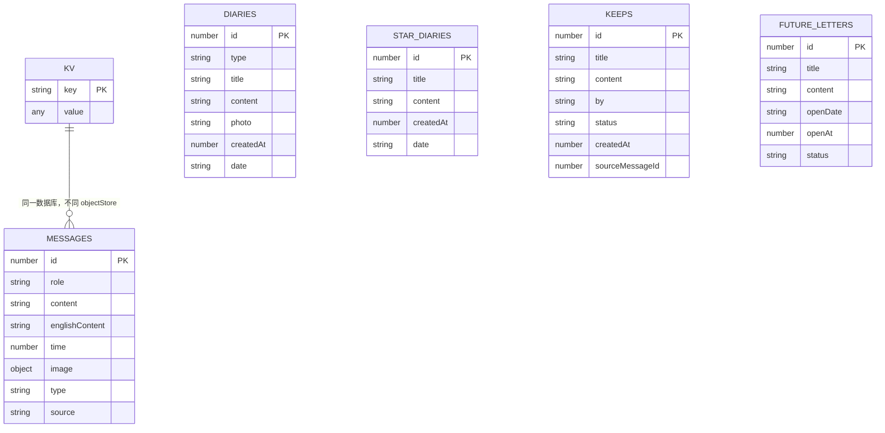

# 05 · 数据存储结构

> 所有业务数据都在浏览器侧。代理层不读任何本地数据（它只看得到请求体）。
> 本页只写结构与字段名，不含任何真实记录。

## 1. 总览

| 载体 | 名称 | 版本 | 用途 | 打开位置 |
|---|---|---|---|---|
| IndexedDB | `star_room` | 3 | 聊天、日记、珍藏、未来信、KV 配置 | `public/app.js:10-38` |
| IndexedDB | `star_butler_v1` | 2 | 生活管家：任务、睡眠、周期、记账 | `public/butler/butler-db.js:12-18` |
| IndexedDB | `ylxh_chat_voice` | 1 | 语音片段 | `public/shared/voice-store.js:15-16` |
| localStorage | 多个 `ylxh.*` 键 | — | 轻量状态与开关 | 见 §4 |
| sessionStorage | 2 个键 | — | 标签页级临时状态 | 见 §5 |
| 内存 | 若干变量 | — | 请求期临时数据，刷新即失 | 见 §6 |

三个数据库**互不引用**：房间不读管家库，管家页面不读聊天库。这是有意的隔离，避免「打开管家抽屉」意外触发聊天数据的全量扫描。

> **关于库名**：`star_room` 是公开文档中统一使用的**示意库名**，原始库名中含个人昵称，故在此替换。版本号、objectStore 结构、字段名与原实现一致；如果你要复用这些结构，请按自己的命名另起库名。



> 上图的连线仅表示「同库」，各表之间**没有外键**；引用关系靠字段软关联（如 `keeps.sourceMessageId`、`futureLetters.replyMessageId`）。

## 2. `star_room`（v3）

建库代码 `public/app.js:14-39`，升级时只「补建缺失的 store」，不删除、不重建。

| objectStore | 主键 | 自增 | 说明 |
|---|---|---|---|
| `kv` | key（外部指定） | — | 配置与长文本 |
| `messages` | `id` | ✅ | 聊天消息 |
| `diaries` | `id` | ✅ | 日记 + 今日便签 + 今日来信（共用表） |
| `starDiaries` | `id` | ✅ | Agent 侧日记 |
| `keeps` | `id` | ✅ | 共同珍藏 |
| `futureLetters` | `id` | ✅ | 未来信 |

### 2.1 `messages`

写入点：`public/app.js:1869-1876`（用户）、`1786-1788`（助手）、`1904/1916`（管家本地回复）。

| 字段 | 类型 | 说明 |
|---|---|---|
| `id` | number | 自增主键 |
| `role` | `'user' \| 'assistant'` | — |
| `content` | string | 正文；图片消息仍以文本为主，图片另存 `image` |
| `englishContent` | string | 可选的英文版本（按需翻译或模型自带） |
| `time` | number | 毫秒时间戳，历史排序**只认这个字段** |
| `image` | object \| null | 图片数据（压缩后的 data URL 或等价结构） |
| `type` | string? | 仅语音消息为 `'voice'` |
| `audioClipId` / `audioMime` / `durationMs` / `asrStatus` | — | 语音消息附加字段 |
| `source` | string? | 管家本地回复标 `'butler'`，用于区分是否消耗过模型调用 |

注意：翻译状态**不落库**，只存在内存 `Map`（`public/app.js:1003-1008`），因此刷新后需要重新翻译。这是为了避免「消息结构随功能扩张」。

### 2.2 `kv` 的键

| key | 内容 | 读写位置 |
|---|---|---|
| `apiKey` | 用户自填的 API Key（明文，浏览器本地） | `public/app.js:4257-4258`、`4501` |
| `settings` | 界面与行为设置 | `public/app.js:1202-1209`、`4314` |
| `longTermMemory` | 长期记忆 v1 整段字符串（只读保留） | `public/app.js:4006` |
| `longTermMemory.v2` | 长期记忆 v2 state（条目 + baseline 镜像） | `long-term-memory-v2.js:22` |
| `weatherLast` | 最近一次天气缓存 | `public/app.js:128`、`653` |

`apiKey` 是明文存放的。这在本项目的威胁模型下（单机、个人使用）可以接受，但如果要多人部署，必须改成不落地的会话凭据。

### 2.3 `keeps` 的状态字段

状态机直接决定「能不能作为记忆证据」（详见 [04 · 历史与记忆](04-memory-and-history.md) 第 6.1 节）：

```
saved │ waiting_star │ waiting_user │ rejected │ rejected_by_user
```

只有 `saved` 会进入上下文注入。

### 2.4 `futureLetters`

关键字段 `openAt`（毫秒）与 `openDate`（`YYYY-MM-DD`）同时存在：前者用于定时比较，后者用于展示与「当天 09:00 开启」的语义。`status` 从 `'sealed'` 开始，开启后写入 `openedAt` 与回复状态。

### 2.5 `diaries` 的一表多义

| `type` | 实际含义 |
|---|---|
| （缺省） | 用户日记 |
| `'today-letter'` | 今日来信 |
| `'note-day'` | 今日便签任务 |

检索注入时必须排除 `note-day`，否则便签会被当日记读进提示词（`public/app.js:1298-1302`）。**这是已知的结构债**：三种语义共用一张表，靠 `type` 区分，任何新查询都要记得过滤。

## 3. `star_butler_v1`（v2）

`public/butler/butler-db.js:20-52` 用 `UPGRADE_STEPS` 做「只增不删」的迁移：

```js
const UPGRADE_STEPS = {
  1: db => { tasks / sleepLogs / cycles / meta },
  2: db => { transactions }   // 只补建，不触碰 v1 数据
};
```

| objectStore | 主键 | 索引 | 说明 |
|---|---|---|---|
| `tasks` | `id` | `by_date`、`by_status` | 待办/任务 |
| `sleepLogs` | `id` | `by_date` | 睡眠记录 |
| `cycles` | `id` | `by_start` | 周期记录（用于预测） |
| `meta` | `key` | — | 单例配置 |
| `transactions` | `id` | `by_date` | 记账 |

字段语义由 `butler-core.js` 定义（纯逻辑，可独立测试）。这些表涉及个人健康与财务数据，**公开仓库不包含任何真实记录**，只有结构与逻辑。

## 4. localStorage

按用途分组（键名保留原样，便于对照）：

| 组 | 键 | 内容 |
|---|---|---|
| 生活 | `ylxh.life.v1` | 在线/交互时间快照（单键 JSON） |
| 生活 | `ylxh.life.log.v1` | 已发生事件（仅短标题 ≤20 字，用于去重） |
| 生活 | `ylxh.life.state.v1` | 聚合状态 |
| 生活 | `ylxh.life.feed.v1` | 展示层缓存 |
| 生活 | `ylxh.life.recall.v1` | 召回节流 |
| 话题 | `ylxh.topic.avoid.v1` / `ylxh.topics.avoid.v1` | 回避规则（上限 8 条） |
| 调度 | `ylxh.sched.v1` / `ylxh.sched.lock.v1` | 调度状态 / 多标签互斥锁 |
| 用量 | `ylxh.ai.usage.v1` | 环形缓冲，最多 2000 条 |
| 语音 | `ylxh.chat.tts.cooldown.v1` | TTS 冷却 |
| 聊天 | `pending_chat_message` | 未发送的草稿 |

> `ylxh` 是项目前缀。公开复用时建议整体替换为自己的命名空间，避免与其他应用撞键。

## 5. sessionStorage

| 键 | 作用 | 为什么用 session |
|---|---|---|
| `ylxh.life.sid` | 当前标签页访问 id | 刷新保留、新标签为空，用于区分「同一次浏览」 |
| `ylxh.transition` | 页面转场标记 | 只对当前标签页的这次跳转有效 |

## 6. 只存在内存、刷新即失的状态

| 变量 | 作用 | 依据 |
|---|---|---|
| `chatHistory` | 已加载的消息数组（请求与渲染的唯一来源） | `public/app.js` 全局 |
| `chatHistoryWindowState` | 历史窗口的左边界状态（滞回用） | `1627` |
| `recallSession` | 跨轮检索的证据 id 集合，**不落库、不进备份** | `1357` 起 |
| `translationState` | 单条消息的翻译状态与防连点锁 | `1003-1008` |
| `pendingReplyRetry` | 上一次失败的重试入口 | `1927-1932` |
| `pendingChatImage` | 已选未发送的图片 | — |

`recallSession` 不持久化是有意的：它只是「这一轮还在说同一件事」的短期判断，落库反而会让旧证据在下次打开时被误当成当前话题。

## 7. 备份与迁移

| 文件 | 作用 |
|---|---|
| `backup-format.js` | 纯函数：把多个 store 序列化为一个带版本号的包，含键白名单 |
| `backup-io.js` | 落盘/读取（浏览器下载与文件选择） |
| `migrate.js` / `cleanup.js` | 一次性数据迁移与清理工具 |
| `purge-today-ui.html` | 清除当日数据的小工具页 |

这几项在原项目里可用，但**公开仓库未纳入**：它们硬编码了真实库名与键白名单，直接公开会把内部数据结构完全暴露，且误操作代价高（`cleanup` 类操作不可逆）。

## 8. 隐私边界

- 本仓库不含任何数据库文件、备份文件或导出文件。
- 文档只描述字段名与语义，不含真实记录内容。
- `apiKey` 明文存于浏览器本地，属于「用户自担风险」的设计；生产化时需替换为服务端会话或短期令牌。
- 管家库涉及睡眠/周期/账单，属于敏感个人数据；若要复用其结构，请先评估合规要求。
