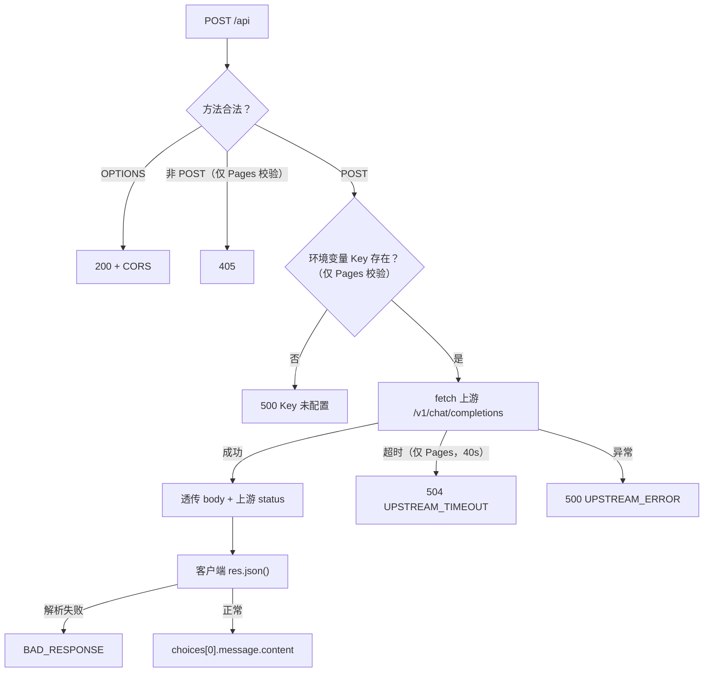
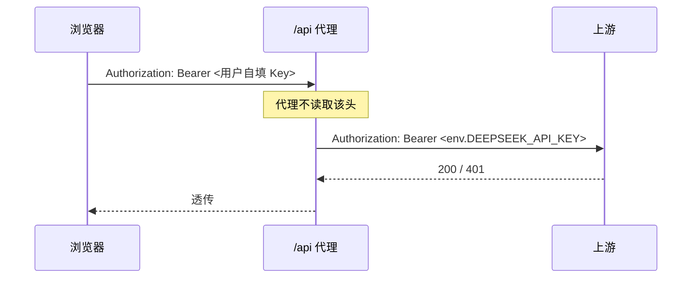

# 06 · API 接口关系

> 前端与代理之间只有一个接口：`POST /api`。本页写清契约、错误语义，以及两套实现之间的差异。

## 1. 接口总表

| 项 | 值 |
|---|---|
| 方法 | `POST`（另有 `OPTIONS` 预检） |
| 路径 | `/api` |
| 请求头 | `Content-Type: application/json`、`Authorization: Bearer <key>` |
| 请求体 | OpenAI 兼容聊天补全参数（见 §2） |
| 响应体 | 上游返回的 JSON 原样透传（见 §3） |
| 实现 A | `src/worker.js` ✅ |
| 实现 B | `functions/api.js` ✅ |
| 上游 | `https://api.deepseek.com/v1/chat/completions` ✅ `src/worker.js:19`、`functions/api.js:4` |

## 2. 请求契约

`ai-client.js:168-179` 实际发出的请求：

```http
POST /api HTTP/1.1
Content-Type: application/json
Authorization: Bearer <用户自填 Key>

{
  "model": "deepseek-flash",
  "messages": [
    { "role": "system", "content": "…" },
    { "role": "user",   "content": "…" }
  ],
  "stream": false
}
```

| 字段 | 来源 | 说明 |
|---|---|---|
| `model` | `opts.model`，默认 `deepseek-flash` | 未做模型白名单校验 |
| `messages` | 组装结果 | 数组元素可为字符串 `content` 或对象数组（多模态） |
| `stream` | 固定 `false` | 当前不走增量流 |

代理**不校验、不改写请求体**，直接 `JSON.stringify(requestBody)` 转发（`src/worker.js:25`、`functions/api.js:45`）。因此新增字段无需改代理，但也意味着代理无法做参数层面的防护。

## 3. 响应契约

客户端只读一个路径（`ai-client.js:196-200`）：

```js
data.choices[0].message.content   // 必须是字符串
```

其余字段仅用于统计：

| 字段 | 用途 |
|---|---|
| `usage.prompt_tokens` / `completion_tokens` / `total_tokens` | 用量统计 |
| `usage.prompt_cache_hit_tokens` / `prompt_cache_miss_tokens` | 缓存命中率 |
| `usage.prompt_tokens_details.cached_tokens` | 命中字段的兼容写法 |

`readUsage`（`ai-client.js:102-148`）的原则：**缺字段就记 `null`，绝不伪造成 0**。否则命中率与费用会被算成假的 0。`miss` 未单列时用 `prompt - hit` 推导，并标记 `derived.miss = true`。

## 4. 错误语义

### 4.1 代理层

| 场景 | Worker | Pages Function |
|---|---|---|
| `OPTIONS` | 200 空体 + CORS ✅ `src/worker.js:7-15` | 200 空体 + CORS ✅ `functions/api.js:17-19` |
| 非 `/api` | 交给静态资源 ✅ `43` | 不进入函数 |
| 非 `POST` 的 `/api` | 进入 `request.json()`，失败落到 500 ✅ `18,37` | 405 `{ error: '只支持 POST' }` ✅ `21-26` |
| 缺环境变量 Key | 不检查，直接转发，由上游返回 401 ✅ `23` | 500 `{ error: 'DEEPSEEK_API_KEY 未配置' }` ✅ `28-35` |
| 上游超时 | 无超时控制 | 504 `{ error: '上游响应超时', code: 'UPSTREAM_TIMEOUT' }` ✅ `46,59-66` |
| 其他异常 | 500 `{ error: message }` ✅ `38` | 500 `{ error, code: 'UPSTREAM_ERROR' }` ✅ `60-66` |



### 4.2 客户端

`ai-client.js:52-95` 把各种失败统一成带 `code` 的 `AIError`：

| code | 触发 |
|---|---|
| `TIMEOUT` | 超过 45 秒（默认） |
| `ABORTED` | 外部 signal 主动取消 |
| `NETWORK` | fetch 抛错（断网、DNS、CORS 等） |
| `HTTP` | `res.ok === false`，保留 `err.status` 与最多 300 字 `detail` |
| `BAD_RESPONSE` | 响应不是合法 JSON，或结构缺 `choices[0].message.content` |
| `NO_KEY` | 本地没有 Key，请求根本没发出 |
| `EMPTY` | 正文为空（`allowEmpty` 为真时改为返回空串） |

这套分类直接决定用户看到哪句话（`friendly()`，`ai-client.js:211-236`），也决定是否出现重试入口（见 [03 · 请求流程](03-request-flow.md) 第 6 节）。

## 5. 关于「客户端自填 Key」的实际去向

这是本项目最容易被误解的一点，需要单独说清。



代码事实：

- 客户端确实把用户自填 Key 放进 `Authorization`（`ai-client.js:172`）。
- Worker 与 Pages 版都用**环境变量**重建 `Authorization`（`src/worker.js:23`、`functions/api.js:43`）。
- 请求体里的字段被原样转发，但 `Authorization` 头被整体替换。

**结论**：在当前的 Worker / Pages 实现下，客户端自填的 Key **不参与上游鉴权**，实际生效的始终是部署环境里的 `DEEPSEEK_API_KEY`。客户端 Key 的唯一作用是「满足本地非空校验」（没有它 `chat()` 直接抛 `NO_KEY`）。

⚠️ **待核实**：这是有意设计（强制走服务端 Key，避免用户 Key 外泄）还是历史遗留，代码与注释都没有说明。公开 README 中「代理端如何处理该 Key，以实际实现为准」的表述即源于此。若要支持「用户自带 Key」，需要代理改为透传客户端的 `Authorization`，并在 CORS 中允许该头。

## 6. CORS 与安全边界

当前配置（`src/worker.js:9-14`、`functions/api.js:8-12`）：

```http
Access-Control-Allow-Origin: *
Access-Control-Allow-Methods: POST, OPTIONS
Access-Control-Allow-Headers: Content-Type
```

三点必须注意：

1. **`Authorization` 不在允许头里**。同源部署（`/api` 与页面同域）不触发预检，所以正常；一旦把前端与代理分域部署，预检会失败。
2. **`*` 不是鉴权**。任何知道地址的人都能调用，消耗的是你的上游额度。
3. **没有限流、没有配额、没有来源校验**。

因此这套代理**只适合个人本地或受控环境**。要公开部署，至少需要：加鉴权（如短期令牌）、限制来源、按 IP/会话限流、给 `messages` 长度设上限。

## 7. 代理可以独立复用吗

可以，但要先改三处：

| 需要改 | 原因 |
|---|---|
| 上游地址与鉴权方式 | 目前硬编码 DeepSeek 与 Bearer |
| 响应头 | 见 §8 |
| 方法/Key 校验 | 两版行为不一致，建议统一 |

代理本身没有业务状态、不读本地数据、不写日志，是一个很干净的薄层——这也是它适合单独公开的原因。

## 8. 已知偏差

| 项 | 现象 | 影响 |
|---|---|---|
| 响应头与请求模式不符 | 客户端发 `stream:false` 并按 JSON 解析；代理返回 `Content-Type: text/event-stream` | 功能正常（body 是 JSON），但头信息误导，任何按 `Content-Type` 分派的中间件都可能出错 |
| 超时语义不一致 | Worker 无超时；Pages 40s；客户端 45s | Worker 部署时，用户的等待完全由客户端 45s 兜底 |
| 错误结构不一致 | Worker 只有 `error`；Pages 有 `error + code` | 客户端目前只读 `res.ok`/`status`，未依赖 `code`，暂不影响 |
| 非 POST 行为不一致 | Worker 落入 500，Pages 返回 405 | 调试时容易误判 |
