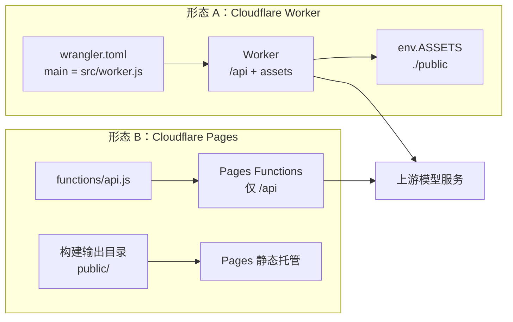

# 07 · 部署与运行说明

> 先说结论：**本仓库不能克隆即用**。它包含文档、配置与三个纯函数模块，但不含入口页面与大部分运行时模块（原因见 §5）。
> 本页说明原项目的两种部署方式，以及在本仓库里能实际运行什么。

## 1. 原项目的两种部署形态



两者选其一即可，不要同时部署同一份前端——`/api` 只应有一个归属。

## 2. 形态 A：Worker

### 2.1 配置

原项目根目录的 `wrangler.toml`：

```toml
name = "star-playground"
main = "src/worker.js"
compatibility_date = "2026-11-01"

[assets]
directory = "./public"
binding = "ASSETS"
```

`[assets]` 是 Workers Static Assets 的绑定方式：`/api` 由代码处理，其余请求交给 `env.ASSETS.fetch(request)`（`src/worker.js:43`）。

### 2.2 步骤

```bash
# 1. 安装依赖（仅 wrangler）
npm install

# 2. 配置密钥（不要写进文件）
npx wrangler secret put DEEPSEEK_API_KEY

# 3. 本地开发
npm run dev          # = wrangler dev

# 4. 部署
npm run deploy       # = wrangler deploy
```

| 项 | 值 |
|---|---|
| Node | 18+（`wrangler@4` 要求） |
| 依赖 | `wrangler ^4.0.0`（devDependency，见仓库 `package.json`） |
| 环境变量 | `DEEPSEEK_API_KEY`（secret） |
| 静态目录 | `./public` |
| 绑定 | `ASSETS` |

### 2.3 注意

- Worker 版**没有上游超时**（`src/worker.js:19-26`）。上游卡住时，靠客户端 45 秒断开。
- Worker 版**不校验** `DEEPSEEK_API_KEY` 是否存在。忘了配置时，用户会看到上游返回的 401，而不是一句能看懂的提示。

## 3. 形态 B：Cloudflare Pages

### 3.1 配置

| 项 | 值 |
|---|---|
| 构建命令 | 无（纯静态，无打包） |
| 输出目录 | `public` |
| Functions 目录 | `functions`（自动识别） |
| 环境变量 | `DEEPSEEK_API_KEY` |

`functions/api.js` 只导出 `onRequest`，因此只拦截 `/api`，其余请求由 Pages 静态托管。

### 3.2 与 Worker 版的差异

| 维度 | Worker | Pages |
|---|---|---|
| 上游超时 | 无 | 40 秒 |
| 缺 Key | 转发后由上游 401 | 本地 500，带中文提示 |
| 非 POST | 落到 500 | 405 |
| 错误码 | 无 `code` | `UPSTREAM_TIMEOUT` / `UPSTREAM_ERROR` |

如果只想要一套，建议保留 Pages 版：它的错误语义更完整，且超时分层（40s < 客户端 45s）能让「上游超时」先于「浏览器断开」被讲清楚。

## 4. 本地运行

### 4.1 跑测试（本仓库可直接执行）

```bash
node --test "tests/shared/*.test.mjs"
```

| 项 | 要求 |
|---|---|
| Node | 18+（`node:test` 内置；实测 22.22.2） |
| 第三方依赖 | **无** |
| 文件 IO | **无**（纯函数测试，不读写磁盘） |
| 实测结果 | `tests/shared/*.test.mjs` → **630 / 630 通过**；其中两个纯函数文件 31 / 31 |

> 传目录的写法（`node --test tests/shared/`）在部分 Node/Windows 组合下会报 `MODULE_NOT_FOUND`，用通配符形式更稳。

**全量跑 `tests/**/*.test.mjs` 会有 21 项失败，原因分三类，均与代码质量无关**：

| 失败项 | 原因 |
|---|---|
| `tests/chat/persona-layers.test.mjs` 等 18 项 | 依赖 `public/persona/*.txt` 的真实人设文本，该目录不随仓库公开 |
| `tests/radio/radio-program.test.mjs` | 依赖 `public/playground/radio-program.js`，该目录不随仓库公开 |
| `L04`/`L05` 两项 | 原项目 `app.js` 已不存在 `needEnglishTranslation()`，测试未同步（既有漂移） |

### 4.2 跑完整前端（需要先补密钥与素材）

`public/` 与两个代理入口都在仓库里，`public/index.html` 引用的 38 个脚本全部存在。真正缺的是三类东西：

1. **密钥**：复制 `.env.example` 为 `.dev.vars`，填入 `DEEPSEEK_API_KEY`。
2. **人设文本**：`public/persona/*.txt`（第一、二层已由 `persona.js` 内置占位示例覆盖，第三至五层与特殊能力按需读取，缺失时自动跳过）。
3. **素材**：音频、表情包图片。缺它们只影响对应功能，不影响页面加载。

`manifest.json` 在该项目目录里**并不存在**——`index.html:7` 的 `<link rel="manifest">` 是悬空引用，所以这项 404 不是本仓库删减造成的。

本地跑法：

| 方式 | 命令 | 说明 |
|---|---|---|
| `wrangler dev` | `npm run dev` | 推荐，`/api` 与静态资源都可用 |
| 任意静态服务器 | `python -m http.server -d public 8000` | `/api` 不可用，聊天发不出去 |

另一个细节：`public/app.js:6-8` 在 `file://` 协议下会把请求指向 `http://127.0.0.1:23210/...`。这是原项目的本地调试转发端口，**本仓库不包含该转发脚本**，所以双击打开 HTML 也无法工作。

## 5. 本仓库包含 / 不包含什么

| 包含 | 说明 |
|---|---|
| 文档 8 篇 | 架构、模块、请求流、记忆、存储、API、部署、索引 |
| `public/` | 入口页、编排层 `app.js`、`shared/` 40 个模块、`butler/` 子系统、样式、清理/迁移页 |
| `src/worker.js`、`functions/api.js` | Worker 与 Pages Function 两个代理入口 |
| `tests/` | 单测与浏览器脚本、迁移演练夹具 |
| `firmware/` | ESP32 触摸与 TLS 对照程序，含 `secrets.example.h` 模板 |
| `package.json`、`package-lock.json`、`wrangler.toml` | 依赖与部署声明 |
| `.env.example` | 环境变量模板 |

| 不包含 | 原因 |
|---|---|
| `public/persona/*.txt` | 私人角色人设正文与个人画像 |
| `public/app.js` 内的第一、二层人设 | 已替换为占位示例文本 |
| `audio/`、表情包图片 | 来源与版权待确认；随素材的私人图片 |
| `public/playground/`、`public/assets/` | 实验页面与构建缓存 |
| `backups/`、`screenshots/`、`docs/persona-v2/`、`docs/bracket-audit-*` | 备份、私人截图、角色设计稿、写作审计数据 |
| `.dev.vars`、`firmware/**/secrets.h`、`kp-final.txt` | 真实密钥与测试输出日志 |
| `MIGRATION.md` | 含真实部署地址与迁移操作流程 |

## 6. 如果你要基于这套结构做自己的项目

按依赖顺序补齐，阻力最小：

1. **先跑通代理**：复制 Worker 或 Pages 版，换成你的上游与 Key，用 `curl` 验证 `/api`。
2. **再做请求管线**：直接用本仓库的 `prompt-layout.js` + `history-window.js`，它们是纯函数，不依赖本项目任何东西。
3. **然后补前端**：从 `AIClient.chat()` 的调用形状出发（`{ url, apiKey, messages, timeoutMs }`），写最小页面即可跑通一次对话。
4. **最后加记忆**：记忆机制与业务强耦合，建议先想清楚「哪些内容需要长期保留」，再参考 [04](04-memory-and-history.md) 的分层，而不是照搬四套机制。

## 7. 安全提醒

- 不要把带通配 CORS、无鉴权的 `/api` 直接暴露到公网（见 [06 · API](06-api.md) 第 6 节）。
- `DEEPSEEK_API_KEY` 只放部署环境的 secret，不要写进仓库、不要写进前端。
- 客户端自填 Key 目前不参与上游鉴权（见 [06 · API](06-api.md) 第 5 节），不要据此认为「用户用自己的额度」。
- 若复用管家库结构（睡眠/周期/账单），先评估当地对敏感个人数据的合规要求。
